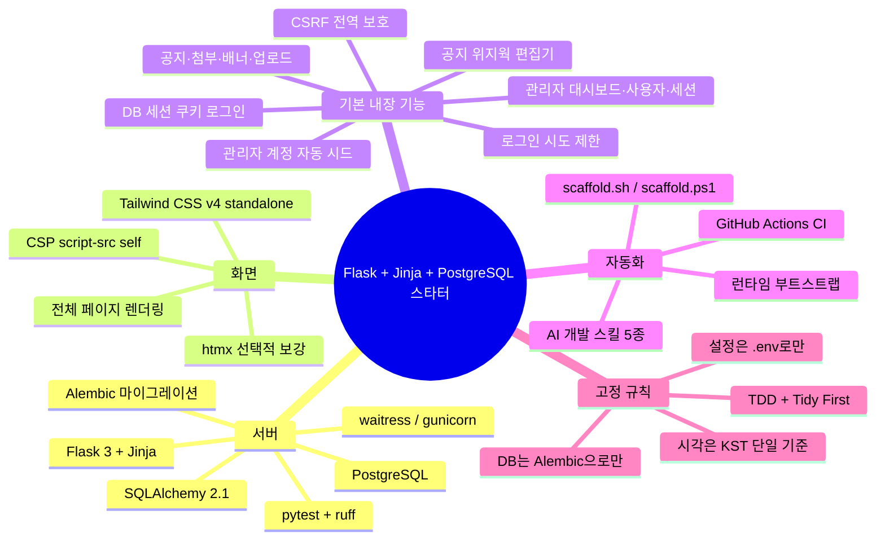
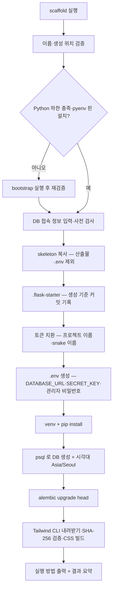
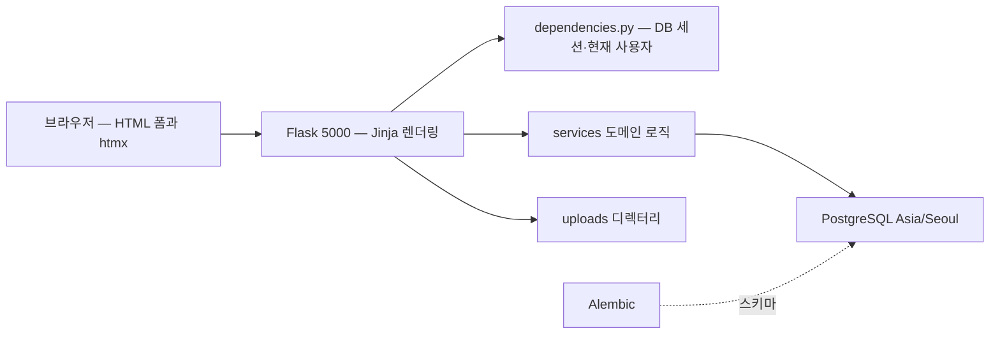

# Flask + Jinja + PostgreSQL 프로젝트 스타터 템플릿

신규 프로젝트를 **스크립트 한 번**으로 만든다.
생성물의 기준(아키텍처·룰)의 원본(SSOT)은 이 폴더다.

```
flask-starter/
├── scaffold.ps1            # ★ Windows (PowerShell) 스캐폴드
├── scaffold.sh             # ★ macOS / Linux / Git Bash 스캐폴드 — 동작 동일
├── LICENSE                 # MIT
├── .github/                # 이 템플릿 저장소 자체의 CI (workflows/template-ci.yml · scripts/ PS 5.1 구문 검사)
├── README.md               # (이 파일)
├── AGENTS.md / CLAUDE.md   # 이 템플릿 저장소 작업용 AI 에이전트 지침 (생성 프로젝트용은 skeleton/ 안)
├── CHANGELOG.md            # 템플릿 변경 이력
├── TODO.md                 # 재개발 작업 계획 (작업 중에만 둔다)
├── docs/                   # 템플릿 문서 — 검토 기록(reviews/)·보관 기록(archive/), 스캐폴드 시 복사 안 됨
├── tools/                  # 생성 프로젝트 점검·공통 계층 동일성 검사 — 스캐폴드 시 복사 안 됨
└── skeleton/               # 새 프로젝트가 받는 골격 전체 (평면 구조)
    ├── README.md           # 사람용 개요·실행 방법
    ├── AGENTS.md           # AI 에이전트 공통 지침 (Codex·Cursor 등 공용)
    ├── CLAUDE.md           # Claude Code 진입점 — @AGENTS.md import
    ├── ARCHITECTURE.md     # 아키텍처 기준(SSOT) — 형제 템플릿과 같은 절 번호
    ├── PLAN.md             # TDD 작업 계획
    ├── docs/               # 프로젝트 고유 문서 (PRD·유저 플로우·기획서 등)
    ├── .claude/skills/     # AI 작업 스킬 5종
    ├── .python-version / .env.example / .gitignore / .gitattributes
    ├── .github/            # 생성된 프로젝트의 CI(workflows/ci.yml) · PS 5.1 구문 검사 · PR 템플릿
    ├── requirements.txt / pyproject.toml / pytest.ini / alembic.ini
    ├── scripts/            # bootstrap · tailwind (sh / ps1) · versions.env · tailwind-sha256sums.txt
    ├── deploy/             # 운영 배포 예시 — systemd · nginx · deploy.sh (Linux)
    ├── app/                # Flask 앱 — web/(뷰) · templates/ · static/(js/editor/ 공지 편집기) + 공통 계층(config·core·db·models·schemas·services)
    ├── alembic/            # 마이그레이션
    └── tests/              # pytest
```

## 한눈에 보기

### 적용 대상

같은 공통 계층(모델·서비스·마이그레이션)을 쓰는 FastAPI 형제 템플릿(`fastapi-react-pg-starter` 등)과 화면 방식이 다르다.

| | 이 템플릿 (Flask + Jinja) | FastAPI + SPA 형제 템플릿 |
|---|---|---|
| 화면 | 서버가 HTML 을 렌더링, htmx 로 일부만 교체 | 브라우저의 SPA 가 API 를 호출 |
| 빌드 체인 | Python 만 — CSS 는 Tailwind standalone CLI | Node·pnpm·Vite |
| 인증 | DB 세션 불투명 토큰을 httpOnly 쿠키로 | access JWT(메모리) + refresh 쿠키 |
| 맞는 경우 | 관리 화면·업무 시스템·폼과 목록 위주의 서비스, 소규모 팀 | 클라이언트 상태가 많은 화면, 모바일 앱과 API 공유 |

### 구성 요소



### 스크립트 한 번으로 무슨 일이 일어나나



### 만들어진 앱이 실제로 도는 모습



## 사용법 — OS별 스크립트

> 저장소를 clone 하거나 fork 한 뒤 템플릿 루트에서 자신의 OS 에 맞는 스크립트를 실행한다.
> 두 스크립트는 같은 `skeleton/` 을 사용하므로 어느 OS 에서 만들어도 결과가 동일하다.

> **생성 위치(`-Target`/`--target`)를 지정하지 않으면** 이 템플릿 폴더의 **부모 폴더에 프로젝트명으로** 생성된다.
> 예: `work/flask-starter/` 에서 `Demo` 를 입력하면 → `work/Demo/` 에 생성(대화형일 땐 기본값을 보여 주고 Enter 로 수락).

### Windows (PowerShell) — `scaffold.ps1`

```powershell
# 대화형 (이름/위치/DB 정보를 물어봄)
.\scaffold.ps1

# 인자 지정
.\scaffold.ps1 -Name MyProject -Target C:\work\MyProject

# 골격만 빠르게 (DB·설치·CSS 빌드 생략)
.\scaffold.ps1 -Name Demo -Target .\Demo -SkipDb -SkipInstall
```

실행 정책 때문에 막히면 `powershell -ExecutionPolicy Bypass -File .\scaffold.ps1 ...` 로 실행한다.

### macOS / Linux / Git Bash — `scaffold.sh`

```bash
chmod +x scaffold.sh          # zip 으로 받아 실행 권한이 없을 때만 (git clone 은 권한이 유지된다)

# 대화형
./scaffold.sh

# 인자 지정
./scaffold.sh --name MyProject --target ~/work/MyProject

# 골격만 빠르게
./scaffold.sh --name Demo --target ./Demo --skip-db --skip-install
```

| PowerShell | bash |
|-----------|------|
| `-Name` `-Target` | `--name` `--target` |
| `-SkipDb` `-SkipInstall` | `--skip-db` `--skip-install` |
| `-DbHost/-DbPort/-DbUser/-DbPassword/-DbName` | `--db-host/--db-port/--db-user/--db-password/--db-name` |
| `Get-Help .\scaffold.ps1 -Detailed` | `-h` `--help` |

### 입력 규칙과 종료 코드

- **프로젝트 이름**: ASCII 영문자·숫자로 시작하고 영문자·숫자·공백·`_`·`-` 만 쓴다(최대 64자). 한글·따옴표·경로 문자는 거부한다. 공백으로 끝날 수 없다. `PascalCase`·공백·`-` 은 `snake_case` 로 바꿔 DB 이름·쿠키 이름에 쓴다(`Demo App` → `demo_app`).
- **대상 폴더**: 비어 있지 않으면 확인을 받는다(비대화형 실행은 중단). 템플릿 저장소 자신·하위·상위 폴더는 거부한다.
- **종료 코드**: `0` 완료, `1` 중단(입력 오류·런타임 미충족 등), `2` 일부 단계 미완료(pip·DB·alembic·CSS 빌드 등 — 마지막 「결과 요약」 참고). `-SkipDb`·`-SkipInstall` 로 생략한 단계는 미완료로 세지 않는다.
- **재실행**: 기존 `.env` 는 `.env.bak.<시각>` 으로 옮기고 소유자 전용 권한을 건다.
- **DB 생성 시** 데이터베이스 기본 시각대를 `Asia/Seoul` 로 설정한다(`ALTER DATABASE … SET timezone`).

### 옵션 플래그

| 플래그 | 효과 |
|--------|------|
| `-SkipDb` | psql DB 생성 + alembic 마이그레이션 생략 |
| `-SkipInstall` | venv/pip 설치 + alembic + Tailwind CSS 빌드 생략 — 「실행 방법」 앞에 생략한 단계를 안내한다 |
| `-DbHost/-DbPort/-DbUser/-DbPassword/-DbName` | DB 접속정보 기본값 — 대화형이면 Enter 로 수락, 비밀번호는 지정하면 묻지 않는다 |

### 사전 요구사항

- Windows: `python` (3.13+), `psql`(선택). macOS/Linux/Git Bash: `python3` (3.13+), `psql`(선택), CSS 빌드용 `curl`·`sha256sum`(또는 `shasum`). **Node·pnpm 은 필요 없다.**
- 하한을 충족하면 **기존 설치본을 그대로 재사용**한다. pyenv 는 하한 미달일 때만 필요하다.
- `psql` 은 PATH 에 없어도 표준 설치 경로(Windows `Program Files\PostgreSQL`, Postgres.app, Homebrew 등)를 찾는다. 없거나 접속할 수 없으면 프로젝트 생성은 계속되고 psql 로 실행할 SQL(`CREATE DATABASE`·시각대)과 alembic 명령이 출력된다.
- CSS 빌드는 처음 한 번 GitHub 에서 Tailwind CLI 를 내려받는다(네트워크 필요). 실패해도 골격은 생성되고 종료 코드 2 로 안내한다.

## 생성 직후

1. 스크립트가 「실행 방법」에 출력한 명령(`.\.venv\Scripts\python -m flask --app app.main run --debug --port 5000`, macOS/Linux 는 `.venv/bin/python …`)을 실행한다(템플릿을 고칠 때는 다른 터미널에서 `scripts/tailwind.*` 감시 빌드).
2. 브라우저 <http://localhost:5000> → 공개 홈 화면이 보이면 성공. `admin` 으로 로그인해 관리자 대시보드에 「DB 정상」과 마이그레이션 리비전이 보이는지 확인한다.
3. 생성 프로젝트의 [`README.md`](skeleton/README.md)·[`PLAN.md`](skeleton/PLAN.md) 를 읽고 TDD(Red→Green→Refactor)로 개발을 시작한다.

개발용 기본 관리자 `admin` 은 기동 시 자동 시드된다. **비밀번호는 스캐폴드가 무작위로 생성**해 `.env` 의 `DEFAULT_ADMIN_PASSWORD` 에 넣고 완료 메시지에 출력한다(고정 기본 비밀번호는 없다).
**운영 배포 전에는** `SECRET_KEY` 교체, `SEED_DEFAULT_ADMIN=false`, `APP_ENV=production`, `COOKIE_SECURE=true`(HTTPS)가 필요하다 — production 에서 안전하지 않은 값이 남아 있으면 앱이 기동을 거부한다.
HTTPS 를 끝내는 리버스 프록시 뒤라면 `TRUSTED_PROXY_HOPS=1` 도 둔다. Linux + nginx + systemd 예시는 생성 프로젝트의 [`deploy/`](skeleton/deploy/README.md) 에 있다.

생성 프로젝트 루트의 `.flask-starter` 에는 생성 기준 커밋(`commit=<해시>`, 커밋하지 않은 변경이 있었으면 `-dirty`, git 없이 받았으면 `unknown`)이 기록된다.
템플릿의 이후 수정은 자동으로 반영되지 않으므로, 이 커밋 이후의 [`CHANGELOG.md`](CHANGELOG.md) 항목을 보고 필요한 변경을 옮긴다.

## 기준이 바뀌면

- **원본만 수정**: [`skeleton/ARCHITECTURE.md`](skeleton/ARCHITECTURE.md)(★핵심 MUST 요약 포함) + 필요 시 `skeleton/AGENTS.md`.
- 이미 생성한 프로젝트에는 템플릿 변경이 자동 동기화되지 않는다. 필요한 변경을 선택해 반영한다.

## 공통 계층

`skeleton/app/` 의 `config.py`·`cli.py`·`core/`·`db/`·`models/`·`schemas/`·`services/` 와 `skeleton/alembic/` 은
형제 템플릿 `fastapi-react-pg-starter`(비공개 저장소)의 `skeleton/backend/` 에서 파일 그대로 가져왔다(공통 테스트·`alembic.ini` 를 포함한 전체 목록은 [`tools/check_common_layer.py`](tools/check_common_layer.py) 의 `COMMON_PATHS`).
이 저장소는 원본을 **단방향으로 추적**하고 공통 파일을 직접 고치지 않는다 — Flask 전용 코드는 `app/web/`·`app/dependencies.py`·`app/main.py` 에만 있다.
그래서 서비스·모델 규칙과 DB 스키마가 형제 템플릿과 같고, 한쪽에서 만든 데이터를 다른 쪽 화면으로 옮기기 쉽다.

동일성은 [`tools/check_common_layer.py`](tools/check_common_layer.py) 로 확인한다. 원본이 비공개 저장소라 템플릿 CI 에서는 돌지 않으므로, 원본을 이 저장소 옆에 두고 로컬에서 실행한다.

```powershell
python -B tools\check_common_layer.py          # 기본 원본 위치: ..\fastapi-react-pg-starter (다르면 --source)
```

종료 코드는 `0` 같음, `1` 차이 있음(파일 목록 출력), `2` 원본을 찾지 못함이다. 줄바꿈(CRLF/LF) 차이는 무시한다.

## 생성 프로젝트 점검

이 스타터로 만든 프로젝트를 여러 개 운영하면 같은 보안 업데이트를 따로 하거나, 한쪽만 스타터 수정을 놓치기 쉽다.
[`tools/check_projects.py`](tools/check_projects.py) 는 스타터(`skeleton/`)와 프로젝트들을 나란히 놓고 한 화면(마크다운)에 모은다.
읽기 전용이며 표준 라이브러리만 쓰므로 설치할 것이 없다(Python 3.13).

```powershell
python tools\check_projects.py ..\project-a ..\project-b             # 버전 · 공통 파일
python tools\check_projects.py ..\project-a ..\project-b --audit     # + 보안 감사(네트워크)
python tools\check_projects.py --audit --files --output 점검.md      # 경로는 tools\projects.local.txt 에서
```

| 절 | 내용 |
|---|---|
| 1. 런타임·도구 | `versions.env`(Python 하한·Tailwind·htmx) · `.python-version` · 벤더링한 `htmx.min.js` 안의 실제 버전 |
| 2. Python 핀 | `requirements.txt` — 값이 서로 다르면 `≠` |
| 3. 공통 파일 | `skeleton/` 과 같은 경로 파일의 같음 · 다름(바뀐 줄 수) · 없음. 치환 토큰은 프로젝트의 표시 이름(`app/main.py` 의 `PROJECT_NAME`)과 snake 이름(`app/dependencies.py` 의 쿠키 이름)으로 바꿔 비교한다. 화면 템플릿(`app/templates/`)과 프로젝트 문서(README·PLAN)는 `--files` 일 때만 표로 낸다 |
| 4. 보안 감사(`--audit`) | 프로젝트 `.venv` 의 설치 목록(없으면 requirements 핀)을 [OSV](https://osv.dev) 로 조회한다. 취약점이 있으면 종료 코드 1 |

- 경로를 주지 않으면 `tools/projects.local.txt`(한 줄에 경로 하나, `#` 주석)를 읽는다. 개인 경로라 `.gitignore` 로 커밋하지 않는다.
- 보안 감사는 패키지 이름과 버전만 `api.osv.dev` 에 보낸다.
- 버전을 맞출지, 스타터 변경을 반영할지는 이 보고서를 보고 사람이 정한다(자동으로 고치지 않는다).

## 문제 해결

- 스캐폴드는 [`skeleton/scripts/versions.env`](skeleton/scripts/versions.env) 의 최소 버전과 `.python-version` 핀을 검사한다. Python 이 하한 미달이거나, pyenv 가 있는데 핀 버전이 설치되어 있지 않으면 OS별 bootstrap 을 실행하고(사유를 함께 출력한다) 다시 검증하며, 실패하면 **복사 전에 중단**한다.
- **이미 하한을 충족하는 Python 이 있으면 pyenv 없이도 진행된다.**
- Windows 에서 **Python 이 하한 미달이고 pyenv-win 도 없으면** bootstrap 이 [공식 pyenv-win 설치 문서](https://pyenv-win.github.io/pyenv-win/docs/installation.html)를 안내하고 중단한다(자동 설치하지 않는다). 설치 후 **새 터미널**에서 다시 실행한다.
- pyenv 가 있어도 `.python-version` 에 핀된 버전을 내려받지 못하면 하한을 충족하는 기존 Python 으로 진행하고 **핀 불일치를 경고**한다.
- **Tailwind 내려받기 실패·SHA-256 불일치**: 내려받은 파일을 쓰지 않고 중단한다. 네트워크·프록시를 확인한 뒤 생성 프로젝트에서 `scripts/tailwind.*` 를 다시 실행한다. 불일치가 계속되면 `tailwind-sha256sums.txt` 와 릴리스 자산을 비교한다(`stack-versions` 스킬 §5-2).
- **Git Bash**: `scaffold.sh` 는 Git Bash 에서도 동작한다. CSS 빌드는 Windows 바이너리를 쓰기 위해 `tailwind.ps1` 을 부른다.

## 버전 고정 정책

| 영역 | 고정 방식 | 값 | SSOT |
|---|---|---|---|
| Python 하한 | 이상이면 기존 설치본 재사용 | `≥ 3.13` | [`versions.env`](skeleton/scripts/versions.env) |
| Python 설치 핀 | pyenv 가 설치·활성화 | `3.13.14` | [`.python-version`](skeleton/.python-version) |
| Python 패키지 | `==` **정확 고정** (재현성 우선) | flask `3.1.3`, werkzeug `3.1.9`, sqlalchemy `2.1.8` 등 20개(전이 의존성 werkzeug·jinja2·markupsafe·itsdangerous 포함) | [`requirements.txt`](skeleton/requirements.txt) |
| Tailwind CSS | standalone CLI 정확 버전 + SHA-256 검증 | `4.3.5` | `versions.env` + [`tailwind-sha256sums.txt`](skeleton/scripts/tailwind-sha256sums.txt) |
| htmx | 벤더링 | `2.0.11` | `versions.env` + `skeleton/app/static/js/htmx.min.js` |
| PostgreSQL | 고정 없음 | 16+ 권장(CI 는 `postgres:16`) | — |

패키지별 전체 목록은 [생성 프로젝트 README 의 기술 스택과 버전](skeleton/README.md#기술-스택과-버전)에 있다.
임의 `pip install -U` 를 금지하며, 핀 상향은 `stack-versions` 스킬의 검증 절차(임시 스캐폴드로 install·pytest 확인)를 따른다. 공통 계층이 쓰는 패키지는 원본 저장소와 같은 핀을 유지한다.

## 템플릿 커스터마이즈

- 생성물의 코드·설정·문서 원본은 [`skeleton/`](skeleton/) 에서 수정한다. 공통 계층 파일은 원본 저장소에서 고친다(위 「공통 계층」).
- [`skeleton/AGENTS.md`](skeleton/AGENTS.md)·[`CLAUDE.md`](skeleton/CLAUDE.md) 와 `add-domain`·`db-migration`·`add-screen`·`pr-workflow`·`stack-versions` [스킬](skeleton/.claude/skills/)은 저장소 안의 규칙을 AI 개발 도구에서 활용하도록 돕는다. 스캐폴드 생성, 애플리케이션 실행, 테스트는 이 파일들 없이도 동작한다.

## 검증 상태

2026-11-23 재개발 중 Windows(Python 3.13.14)에서 다음 결과를 확인하였다. 이 목록은 그 시점의 기록이며, 이후 검증 결과(PostgreSQL 마이그레이션 왕복, 브라우저 확인, GitHub Actions 통과 등)는 [`CHANGELOG.md`](CHANGELOG.md) 각 항목의 「검증」에 있다.

- `scaffold.ps1`(PowerShell 5.1)·`scaffold.sh`(Git Bash)로 `-SkipDb` 생성 → 두 결과물이 비밀값을 빼고 같음, 잔여 토큰 없음, `.env` 키 집합 = `.env.example`
- 생성물: pytest `163 passed`, `ruff check` 경고 `0`, Tailwind CLI 내려받기·SHA-256 검증·빌드 성공
- 임시 프로젝트에서 SQLite 로 `alembic upgrade head` 성공, waitress 로 기동해 공개·관리자 화면 HTTP 200, 로그인, CSP 헤더 확인
- 정적 검사: 모든 `.ps1` 이 PowerShell 5.1 파싱·PS7 토큰 검사 통과, 모든 `.sh` 가 `bash -n`·ShellCheck 0.11.0(`-S warning`) 통과, 공통 계층 동일, 점검 도구 단위 테스트 `28 passed`
- 미검증: PostgreSQL 대상 마이그레이션 왕복과 스캐폴드 DB 단계(로컬 PostgreSQL 접속 정보 없음), 브라우저 실동작(htmx 교체·콘솔 CSP 위반 없음), macOS/Linux 실행, GitHub Actions 실제 실행(push 전)

자동 검증은 두 워크플로가 담당한다.

- [`skeleton/.github/workflows/ci.yml`](skeleton/.github/workflows/ci.yml) — **생성된 프로젝트**용.
  `app`(Ubuntu·Windows, ruff + pytest) / `css`(Ubuntu `tailwind.sh`·Windows `tailwind.ps1`) / `migrations`(`postgres:16` 서비스 컨테이너로 Alembic 왕복) /
  `powershell-syntax`(PowerShell 5.1 구문 검사) / `audit`(`pip-audit`, 경고성)
- [`.github/workflows/template-ci.yml`](.github/workflows/template-ci.yml) — **이 템플릿 저장소**용.
  `.ps1`·`.sh` 구문 검사(ShellCheck 게이트), `versions.env` 와 벤더링 자산(htmx·Tailwind 해시 파일)의 버전 정합,
  Ubuntu·macOS 에서 `scaffold.sh` 를 실제로 실행해 **템플릿 오염·잔여 토큰·`.env` 키 집합을 회귀 검사**하고 생성물의 pytest·CSS 빌드를 돌린다(`scaffold-posix`).
  Windows 에서는 `scaffold.ps1`(PowerShell 5.1)과 `scaffold.sh`(Git Bash) 생성물이 같은지 비교하고 생성물 pytest·`tailwind.ps1` 을 돌린다(`scaffold-windows`).
  생성물을 `postgres:16` 에 붙여 Alembic 왕복을 하고(`migrations-postgres`), `pip-audit` 를 차단 단계로 실행하며(`dependency-audit`), 점검 도구 단위 테스트를 돌린다(`tools-test`).

## 라이선스와 기여

이 프로젝트는 [MIT License](LICENSE)로 배포된다.
변경 이력은 [`CHANGELOG.md`](CHANGELOG.md)에서 확인할 수 있으며,
버그 수정이나 개선은 한 가지 목적에 집중한 이슈 또는 pull request 로 제안해 주세요.
