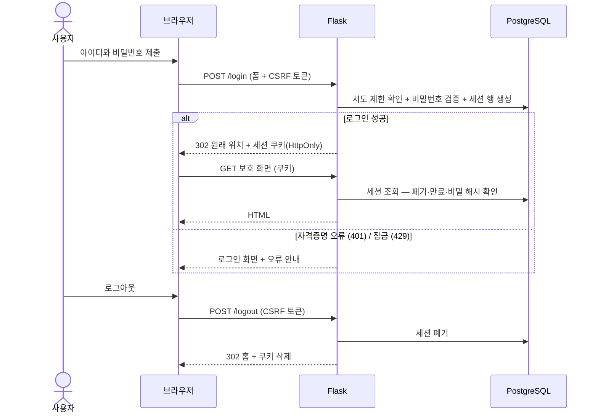
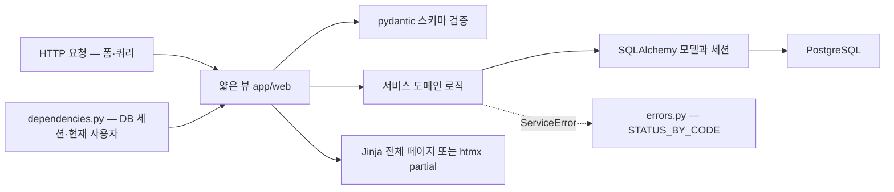
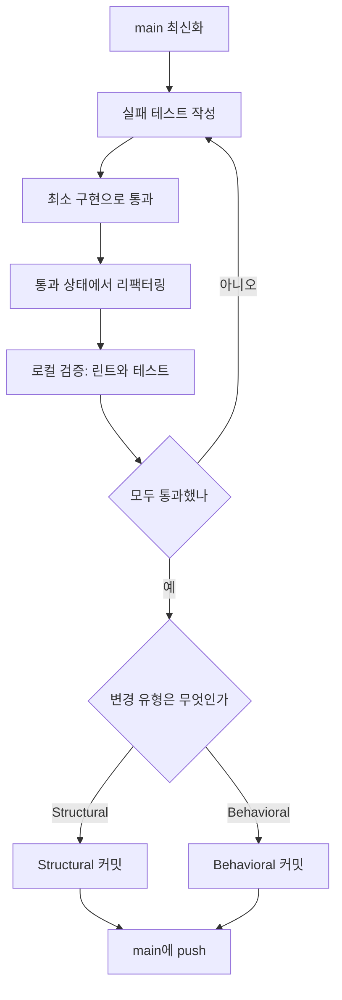

# __PROJECT_NAME__

`flask-starter` 로 생성된 Flask · Jinja · PostgreSQL 프로젝트다. 서버 렌더링 화면, DB 세션 기반 자체 계정 인증, 공지·배너·업로드·관리자 화면, Alembic 마이그레이션 골격을 함께 제공한다. 화면 일부는 htmx 로 보강하고, CSS 는 Node 없이 Tailwind CSS standalone CLI 로 빌드한다.

## 빠른 시작

### 스캐폴드 생성 직후

스캐폴드가 의존성 설치·CSS 빌드·DB 마이그레이션까지 마쳤다면 서버를 실행한다. 템플릿의 Tailwind 클래스를 고치는 동안에는 다른 터미널에서 CSS 감시 빌드를 함께 띄운다.

```powershell
# Windows — 터미널 1
.\.venv\Scripts\python -m flask --app app.main run --debug

# Windows — 터미널 2 (템플릿을 고칠 때)
.\scripts\tailwind.ps1 -Watch
```

```bash
# macOS / Linux — 터미널 1
./.venv/bin/python -m flask --app app.main run --debug

# macOS / Linux — 터미널 2 (템플릿을 고칠 때)
./scripts/tailwind.sh --watch
```

브라우저에서 <http://localhost:5000> 에 접속하면 로그인 없이 공개 홈 화면이 보인다. `admin`(비밀번호는 `.env` 의 `DEFAULT_ADMIN_PASSWORD`)으로 로그인하면 관리자 대시보드로 이동한다.

### 다른 머신에서 clone 한 경우

clone 한 저장소에는 실제 `.env`, 설치된 의존성, 빌드된 CSS(`app/static/css/app.css`)가 없다. 다음 순서로 준비한다. 명령은 모두 프로젝트 루트에서 실행하며, `DATABASE_URL` 은 먼저 생성했거나 접근 가능한 PostgreSQL 데이터베이스를 가리켜야 한다.

1. 런타임을 확인하고 환경 파일을 만든다.

```powershell
# Windows
.\scripts\bootstrap.ps1 -WithPostgres
Copy-Item .env.example .env
```

```bash
# macOS / Linux
./scripts/bootstrap.sh --with-postgres
cp .env.example .env
```

2. `.env` 의 `DATABASE_URL` 과 `SECRET_KEY`(예: `openssl rand -hex 32`)를 개발 환경에 맞게 설정한다. 기본 관리자를 시드하려면 `DEFAULT_ADMIN_PASSWORD` 도 채운다.
3. 의존성을 설치하고 CSS 를 빌드한다. Tailwind CLI 는 처음 한 번 `.tools/` 에 내려받고 `scripts/tailwind-sha256sums.txt` 의 SHA-256 과 맞을 때만 쓴다.

```powershell
# Windows
python -m venv .venv
.\.venv\Scripts\python -m pip install -r requirements.txt
.\scripts\tailwind.ps1
```

```bash
# macOS / Linux
python3 -m venv .venv
./.venv/bin/python -m pip install -r requirements.txt
./scripts/tailwind.sh
```

4. 서버를 띄우기 전에 마이그레이션을 적용한다.

```powershell
# Windows
.\.venv\Scripts\python -m alembic upgrade head
```

```bash
# macOS / Linux
./.venv/bin/python -m alembic upgrade head
```

그다음 위의 「스캐폴드 생성 직후」 명령으로 서버를 실행한다. 새로 설치한 런타임이 있다면 PATH 반영을 위해 터미널을 다시 연다.

bootstrap 은 **하한을 충족하는 Python 이 이미 있으면 pyenv 없이 그대로 사용**한다. 버전 관리자는 Python 이 하한에 못 미칠 때만 필요하며, Windows 에서 Python 이 부족하고 pyenv-win 도 없으면 [공식 설치 문서](https://pyenv-win.github.io/pyenv-win/docs/installation.html)를 안내하고 중단한다(자동 설치하지 않는다). 관리자 없이 진행하면 `.python-version` 핀과 실제 버전이 다를 수 있으며, 그 경우 경고를 출력한다.

## 런타임 구조

브라우저는 Flask 가 렌더링한 HTML 을 받는다. htmx 가 붙은 요청(`HX-Request`)에는 같은 뷰가 화면 일부(partial)만 돌려준다. Alembic 은 요청 경로와 별도로 DB 스키마를 관리한다.

```mermaid
flowchart LR
    Browser["브라우저 — HTML 폼과 htmx"] --> Flask["Flask 5000 — Jinja 렌더링"]
    Flask --> Service["services 도메인 로직"]
    Service --> ORM["SQLAlchemy 세션"]
    ORM --> DB["PostgreSQL"]
    Flask --> Uploads["uploads 디렉터리"]
    Alembic["Alembic 마이그레이션"] -. 스키마 적용 .-> DB
    Tailwind["Tailwind standalone CLI"] -. app.css 빌드 .-> Flask
```

운영에서는 개발 서버(`flask run`) 대신 WSGI 서버로 앱 팩토리를 띄운다 — `waitress-serve --call app.main:create_app`(Windows·Linux) 또는 `gunicorn "app.main:create_app()"`(Linux). HTTPS 는 앞단 프록시가 맡는다.

## 화면 구성

| 영역 | 경로 | 내용 |
|------|------|------|
| 공개 | `/` | 노출 중인 배너 · 최근 공지 |
| | `/notices`, `/notices/<id>` | 공지 목록(고정·검색·페이지 — 검색은 htmx 예제) · 상세(본문·첨부 다운로드) |
| | `/login`, `/logout`(POST) | 로그인(원래 위치로 복귀) · 로그아웃 |
| 관리자 | `/admin/` | 대시보드 — 사용자·세션·공지·배너 수, DB 상태, 마이그레이션 리비전 |
| | `/admin/notices` | 공지 작성·수정·삭제(본문은 HTML — 저장 시 nh3 로 정화), 첨부 업로드·다운로드, 본문 이미지 업로드 |
| | `/admin/banners` | 배너 이미지 업로드, 링크·노출 기간, 활성 여부, 순서 변경(htmx 예제) |
| | `/admin/users`, `/admin/sessions` | 역할·활성 변경(행 저장은 htmx 예제), 세션 강제 종료, 로그인 잠금 해제 |
| API | `/api/v1/health`, `/api/v1/health/db` | 헬스 체크(JSON) |
| | `/api/v1/notices/<id>/attachments/<aid>` | 게시된 공지의 첨부 다운로드 |

- `/admin/*` 는 비로그인이면 로그인 화면으로, 로그인하였지만 관리자가 아니면 403 으로 보낸다. htmx 요청이면 401 과 `HX-Redirect` 로 로그인 화면을 연다.
- 업로드 파일은 `UPLOAD_DIR`(기본 `uploads/`)에 저장된다. `public/`(본문·배너 이미지)만 `/uploads/public/` 으로 서빙하고, `private/`(공지 첨부)는 다운로드 경로로만 내려간다.
- 공지 본문 편집기는 HTML textarea 다. 본문 이미지는 업로드 후 돌려받은 `` 코드를 본문에 붙여 넣는다.

## 인증과 기본 계정

username/password 로그인을 기본 제공한다. 로그인하면 `auth_sessions` 에 세션 행을 만들고 불투명 토큰(`<세션 id>.<비밀>`)을 `__PROJECT_SNAKE___session` 쿠키(`HttpOnly`, `SameSite=Lax`)로 보낸다. DB 에는 비밀의 해시만 저장하고, 요청마다 세션의 폐기·만료 여부를 확인한다. 세션 수명은 `REFRESH_TOKEN_EXPIRE_DAYS`(기본 14일)다 — 키 이름은 형제 FastAPI 템플릿과 공유하는 설정 코드(`app/config.py`)를 따른다. Flask 의 서명 쿠키 `__PROJECT_SNAKE___flash` 는 flash 메시지와 CSRF 토큰에만 쓴다.

처음 앱을 실행할 때 `admin` 계정이 없고 `SEED_DEFAULT_ADMIN=true` 이면 개발용 관리자 `admin` 이 시드된다. **비밀번호는 고정값이 없다** — 스캐폴드가 무작위로 생성해 `.env` 의 `DEFAULT_ADMIN_PASSWORD` 에 넣고 완료 메시지에 출력한다. 시드는 계정이 없을 때만 동작하므로, 이미 만든 계정의 비밀번호는 바뀌지 않는다. 운영 계정은 CLI 로 만든다.

```bash
python -m app.cli create-admin --username ops-admin   # 비밀번호는 프롬프트로 입력
python -m app.cli set-password --username admin
```

> [!CAUTION]
> **기본 관리자 시드는 로컬 개발 전용이다.** 배포 전 반드시 `SECRET_KEY` 를 교체하고, `SEED_DEFAULT_ADMIN=false`·`APP_ENV=production`·`COOKIE_SECURE=true`(HTTPS)로 설정한다. `APP_ENV=production` 에서 기본·짧은 `SECRET_KEY`, 관리자 시드, `COOKIE_SECURE=false`, `BCRYPT_ROUNDS` 12 미만 중 하나라도 남아 있으면 앱이 기동을 거부한다. 전체 항목은 `ARCHITECTURE.md` §21 「배포 전 체크리스트」를 확인한다.

- 같은 계정으로 연속 `LOGIN_MAX_FAILURES`(기본 5)회 실패하면 `LOGIN_LOCKOUT_MINUTES`(기본 15분) 동안 로그인이 **429** 로 거부된다.
- 로그인 후 이동할 `next` 경로는 같은 사이트의 상대 경로만 허용한다(`safe_next_path`).



## 프로젝트 구조와 기능 확장

뷰는 HTTP 처리와 화면 선택만 맡고, 업무 로직은 `services/`, 입력 검증은 `schemas/`(pydantic), 영속 모델은 `models/` 에 둔다. 폼 값은 `app/web/forms.py` 의 `parse_form` 이 pydantic 스키마로 검증하고, 오류는 필드별 메시지로 템플릿에 돌려준다.



| 경로 | 역할 |
|---|---|
| `app/main.py` | 앱 팩토리 `create_app()` — 설정 검사, CSRF, 보안 헤더, 오류 처리, 블루프린트 등록, 관리자 시드 |
| `app/dependencies.py` | 요청별 DB 세션, 현재 사용자, `login_required`·`admin_required`, 인증 쿠키 |
| `app/web/` | 블루프린트(`public`·`auth`·`admin`·`api`·`files`)와 공용 헬퍼(`htmx`·`forms`·`pagination`·`errors`·`security_headers`) |
| `app/templates/` | Jinja 템플릿 — `base.html`, 영역별 폴더, htmx 응답용 `partials/` |
| `app/static/` | `css/input.css`(Tailwind 입력), `js/htmx.min.js`(벤더링), `js/app.js` |
| `app/config.py`·`app/core/`·`app/db/`·`app/models/`·`app/schemas/`·`app/services/`·`alembic/` | 형제 FastAPI 템플릿과 같은 공통 계층 |
| `scripts/` | bootstrap, Tailwind 빌드, 버전 기록(`versions.env`) |
| `tests/` | pytest — Flask `test_client` 로 화면·API, 서비스 단위 테스트 |
| `.github/` | GitHub Actions CI(`workflows/ci.yml`), PowerShell 5.1 구문 검사 스크립트, PR 템플릿 |

세부 디렉터리와 계층 규칙은 `ARCHITECTURE.md` §4·§8 을, 새 도메인 추가 절차는 [`add-domain` 스킬](.claude/skills/add-domain/SKILL.md)을 따른다.

## 개발 워크플로

`main` 에서 TDD 의 Red → Green → Refactor 순서로 진행하고 바로 커밋·push 한다. 브랜치와 PR 은 선택이다. Structural 과 Behavioral 변경은 한 커밋에 섞지 않는다.

PR 리뷰 단계가 없으므로 push 전에 로컬 검증을 통과시킨다 — 검증을 건너뛰면 깨진 코드가 곧바로 `main` 에 남는다. 검증 명령과 상세 절차는 [`pr-workflow` 스킬](.claude/skills/pr-workflow/SKILL.md)에 있다.



되돌리기 어렵거나 광범위한 변경, 중간 상태를 `main` 에 두고 싶지 않을 때, 리뷰가 필요할 때는 브랜치를 따고 PR 을 만든다. 협업자가 생기면 `main` 브랜치 보호를 켜고 PR 흐름을 기본으로 되돌리는 것을 권장한다. 이 흐름을 바꾸면 `ARCHITECTURE.md` §22 에 기록한다.

## DB 마이그레이션

DB 스키마는 Alembic 으로만 변경한다. 자동 생성 결과를 검토한 뒤 적용하고, 런타임 `create_all` 이나 수동 `ALTER` 로 우회하지 않는다.

```powershell
# Windows
.\.venv\Scripts\python -m alembic revision --autogenerate -m "변경요약"
.\.venv\Scripts\python -m alembic upgrade head
```

```bash
# macOS / Linux
./.venv/bin/python -m alembic revision --autogenerate -m "변경요약"
./.venv/bin/python -m alembic upgrade head
```

자세한 검토와 롤백 원칙은 `ARCHITECTURE.md` §11 과 [`db-migration` 스킬](.claude/skills/db-migration/SKILL.md)을 참고한다.

## 테스트와 품질 검사

```powershell
# Windows
.\.venv\Scripts\python -m ruff check .
.\.venv\Scripts\python -m pytest -q
```

```bash
# macOS / Linux
./.venv/bin/python -m ruff check .
./.venv/bin/python -m pytest -q
```

테스트는 임시 SQLite 파일 DB 와 임시 업로드 폴더를 쓰므로 PostgreSQL 없이 돈다. 마이그레이션 검증만은 실제 PostgreSQL 에서 한다([`db-migration` 스킬](.claude/skills/db-migration/SKILL.md)).

### CI (GitHub Actions)

`main` 에 push 하거나 PR 을 열면 [`.github/workflows/ci.yml`](.github/workflows/ci.yml) 이 돈다. push 이후에 도는 사후 안전망이며, 게이트는 위의 로컬 검증이다.

| 잡 | 내용 |
|---|---|
| `app` | Ubuntu·Windows 에서 `pip check`·`ruff check`·`pytest`(`DeprecationWarning` 은 실패) |
| `css` | Ubuntu 는 `tailwind.sh`, Windows 는 PowerShell 5.1 로 `tailwind.ps1` — 내려받기·SHA-256 검증·빌드 |
| `migrations` | `postgres:16` 서비스 컨테이너에 `alembic upgrade head` → `check` → `downgrade base` → `upgrade head` |
| `powershell-syntax` | 모든 `.ps1` 을 Windows PowerShell 5.1 로 파싱하고 PS7 전용 문법을 찾는다 |
| `audit` | `pip-audit -r requirements.txt` — 경고성(새 CVE 로 CI 가 실패하지 않게 `continue-on-error`). 로그를 주기적으로 확인한다 |

## 환경 설정

- 설정은 프로젝트 루트의 `.env` 하나다(스캐폴드가 생성, 키 목록과 설명은 `.env.example`). `DATABASE_URL`, `SECRET_KEY`, `APP_ENV`, 로그인 세션 수명(`REFRESH_TOKEN_EXPIRE_DAYS`), 로그인 시도 제한(`LOGIN_MAX_FAILURES`·`LOGIN_LOCKOUT_MINUTES`), 쿠키 `Secure`(`COOKIE_SECURE`), 업로드(`UPLOAD_DIR`·`MAX_*_UPLOAD_MB`), 기본 관리자 시드(`SEED_DEFAULT_ADMIN`·`DEFAULT_ADMIN_PASSWORD`)를 여기서 설정한다.
- 실제 `.env` 파일은 커밋하지 않는다. 배포 전에는 위 기본 계정 경고와 `ARCHITECTURE.md` §21 을 다시 확인한다.
- Unix 계열은 `TZ=Asia/Seoul` 을 프로세스 시각대에 적용한다. Windows 는 OS 시각대를 서울(UTC+9)로 설정해야 하며, 불일치하면 애플리케이션이 경고한다.

## 기술 스택과 버전

| 표기 | 의미 |
|---|---|
| `≥ X` | **하한**. 이상이면 기존 설치본을 그대로 재사용하고, 미만이거나 없을 때만 설치한다. |
| `== X.Y.Z` | **정확 고정**. 재현성 우선 — 다른 버전이 설치되지 않는다. |

### 런타임·도구

| 항목 | 고정 | 출처 |
|---|---|---|
| Python | 하한 ≥ 3.13, 설치 핀 `3.13.14` | [`scripts/versions.env`](scripts/versions.env) `MIN_PYTHON` · [`.python-version`](.python-version) |
| Tailwind CSS standalone CLI | `4.3.5` 정확 고정 + SHA-256 검증 | `versions.env` `TAILWIND_VERSION` · [`scripts/tailwind-sha256sums.txt`](scripts/tailwind-sha256sums.txt) |
| htmx | `2.0.11` 벤더링 | `versions.env` `HTMX_VERSION` · `app/static/js/htmx.min.js` |
| PostgreSQL | 고정 없음 | 16+ 권장(14 는 2026-11 지원 종료) |

### Python 패키지 — 전부 `==` 정확 고정

재현성을 우선한다. ⛔ 임의 `pip install -U` 금지 — 상향은 `stack-versions` 스킬의 검증 절차를 따른다. SSOT 는 [`requirements.txt`](requirements.txt).

| 패키지 | 고정 버전 | 패키지 | 고정 버전 |
|---|---|---|---|
| flask | `== 3.1.3` | pydantic | `== 2.14.2` |
| werkzeug (Flask 하위 — 직접 고정) | `== 3.1.9` | pydantic-settings | `== 2.16.2` |
| flask-wtf (CSRF) | `== 1.3.0` | PyJWT (공통 `core/security.py` 가 import) | `== 2.15.1` |
| wtforms | `== 3.3.2` | bcrypt | `== 5.0.0` |
| waitress (운영 WSGI) | `== 3.0.2` | nh3 (본문 HTML 정화) | `== 0.3.7` |
| gunicorn (운영 WSGI, Windows 제외) | `== 27.0.1` | pillow (업로드 이미지 재인코딩) | `== 13.0.0` |
| sqlalchemy | `== 2.1.8` | pytest | `== 9.2.0` |
| alembic | `== 1.20.1` | ruff | `== 0.17.3` |
| psycopg2-binary | `== 2.9.13` | | |

## 상세 문서

- [`ARCHITECTURE.md`](ARCHITECTURE.md): 이 프로젝트의 아키텍처, MUST 규칙과 배포 전 체크리스트
- [`PLAN.md`](PLAN.md): TDD 작업 순서와 기능별 체크리스트
- [`AGENTS.md`](AGENTS.md): 저장소 안에서 자립적으로 동작하는 AI 에이전트 공통 지침([`CLAUDE.md`](CLAUDE.md)가 import)
- [`docs/`](docs/README.md): PRD·유저 플로우·기획서 등 프로젝트 고유 문서
- [`.claude/skills/`](.claude/skills/): 도메인 추가, 마이그레이션, 화면 추가, 커밋과 버전 작업을 위한 선택적 작업별 가이드
